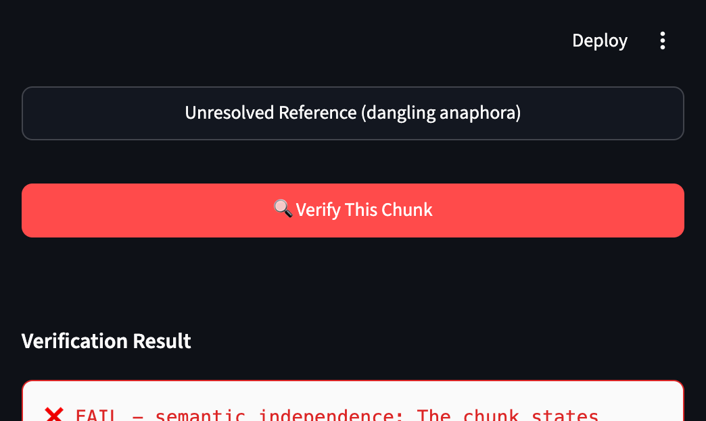

# rag-verifier

[](LICENSE)
[](https://github.com/hlc0000/rag-verifier/actions/workflows/ci.yml)
[](pyproject.toml)

🎯 **[Online Demo](https://rag-verifier.streamlit.app)** · 📦 `pip install git+https://github.com/hlc0000/rag-verifier.git`



Most RAG failures aren't model failures — they're evidence failures. A clause gets split mid-condition: `If the Client breaches any material obligation,` goes into one vector, `the Contractor may terminate this Agreement.` into another. Both chunks look fine to your retriever; neither is answerable on its own. And when the LLM finally answers, it quotes a citation that *sounds* right — with the trigger condition quietly cut away.

rag-verifier is a quality gate for that evidence layer. It checks every chunk **before** it enters your vector store, and every citation **before** it reaches your user.

## What it does

Five checks run sequentially on each chunk. The rule layer is fast (pure regex, ~0.5% false-positive rate measured on 1,388 chunks from 20 real documents) and catches structural defects deterministically. The LLM semantic layer kicks in only when the rule layer says "looks OK" but the chunk might still be semantically broken (missing trigger condition, elided subject).

| Check | Rule layer (fast filter) | LLM semantic layer (fallback) |
|---|---|---|
| independence | dependent connective at start (However/Therefore/Accordingly), incomplete conditional ending (If/When/Unless), fragments, empty chunks, table-continuation markers | trigger condition cut away, elided subject |
| completeness | conditional pairings, concessive pairings, dependent connective with word boundary | — |
| traceability | unresolved anaphora (this/that/it with no referent in-chunk), cross-chunk substantive references (as shown in Figure 2) | — |
| template_completeness | bracketed placeholders (`[yyyy]`), underscore blanks, quantity/date/signature slots | — |
| semantic_independence | — | full independent judgment with the complete document as context |

The LLM layer is fail-open: if the API is down, the chunk gets `uncertain`, **never** silently reclassified as `supported` or `insufficient`.

## Installation

```bash
pip install git+https://github.com/hlc0000/rag-verifier.git
```

The core verification layer is **zero-dependency** (pure stdlib — the LLM calls go through `urllib`). Optional extra for document parsing (PDF/DOCX/Markdown/HTML):

```bash
pip install "rag-verifier[parse] @ git+https://github.com/hlc0000/rag-verifier.git"
```

<details><summary>Development install (editable)</summary>

```bash
git clone https://github.com/hlc0000/rag-verifier.git
cd rag-verifier
pip install -e ".[parse]"
```

</details>

## Usage

### Chunk quality gate (rule layer: fast, zero LLM calls)

```python
from rag_verifier import verify_chunk

result = verify_chunk(
    "Therefore the Contractor has the right to claim damages from the Client.",
    prev_chunk="If the Client breaches any material obligation under this Agreement,",
)
# result["overall"].value == "fail"
# result["checks"]["independence"]["reason"] == "Starts with a dependent connective: 'Therefore'"
```

### Citation faithfulness (does the citation actually support the claim?)

Three-way verdict, plus `uncertain` when the LLM is unavailable:

- `unsupported` — citation contradicts the claim → regenerate the answer
- `insufficient` — citation is incomplete or off-topic → re-retrieve
- `supported` — citation both entails the claim and stands alone without misleading

```python
from rag_verifier import verify_citation

result = verify_citation(
    claim="Apache License 2.0 requires copyright headers.",
    citation="Copyright [yyyy] [name of copyright owner]",
    source_text="... full Apache 2.0 license text ...",
)
# result["status"] / result["reason"] / result["checks"]
```

A deterministic gate runs **before** any LLM call: if the citation is located verbatim in the source and its preceding context shows a truncated conditional (the citation kept only the result clause), the verdict is `insufficient` immediately — no LLM variance, no API cost.

### With the LLM semantic layer

```bash
export LLM_API_KEY=sk-xxx
export LLM_BASE_URL=https://api.deepseek.com/v1   # any OpenAI-compatible endpoint
export LLM_MODEL=deepseek-chat
```

```python
from rag_verifier import verify_chunk, builtin_llm

result = verify_chunk(
    "Therefore Party A has the right to claim compensation from Party B.",
    prev_chunk="If Party B breaches the confidentiality obligation,",
    full_doc="If Party B breaches the confidentiality obligation, therefore Party A ...",
    llm_callback=builtin_llm,   # inject any LLM callable; without it the semantic check returns uncertain
)
```

### Full pipeline: parse → split → verify

```python
from rag_verifier.parsing import parse_document
from rag_verifier.chunking import split_document
from rag_verifier import verify_chunk

doc = parse_document("contract.pdf")      # StructuredDocument
chunks = split_document(doc)              # list[dict]: {"id", "card", "source_text", ...}

prev = ""
for item in chunks:
    content = item["card"]["content"]
    result = verify_chunk(content, prev_chunk=prev)
    if result["overall"].value == "fail":
        failed = [f"{k}: {v['reason']}" for k, v in result["checks"].items() if v["status"] == "fail"]
        print(f"DROP {item['id']}: {'; '.join(failed)}")
    prev = content
```

## How it fits in the RAG quality stack

This is one layer of a healthy stack, designed to compose with the others:

- **Structure-aware chunkers** (e.g. chunkcite) decide *where to cut*. rag-verifier runs after any chunker — yours, theirs, LangChain's — and gates *what may pass*.
- **Citation-side checkers** (e.g. spancheck) verify that quoted spans exist. We go one step further into *faithfulness*: a verbatim quote can still be `insufficient` if its trigger condition was cut away.
- **Static context analyzers** (e.g. ContextDoctor) lint your context before retrieval. We add a fail-open LLM semantic layer on top of deterministic rules, in both Chinese and English.

Parse with anything, chunk with anything, gate with rag-verifier.

## Supported formats

Text-layer PDF, DOCX, TXT, Markdown, HTML. Not supported: RTF (no heading styles → levels lost), scanned PDF (no OCR, empty text layer).

## Bilingual (zh / en)

Every rule has a Chinese and an English copy, dispatched automatically by `detect_language()` (CJK ratio ≥ 15% → zh). The prompt templates, the `reason` strings, and the three citation verdicts all come in matching pairs. Run your document in English → English output. Run in Chinese → Chinese output. Never mixed.

`scripts/rule_parity_check.py` runs the positive and negative examples for every rule in both languages and fails the build if any positive case is missed or any negative case is hit by accident.

## Tests

```bash
python scripts/rule_parity_check.py    # zh/en rule parity — must pass (runs in CI)
```
